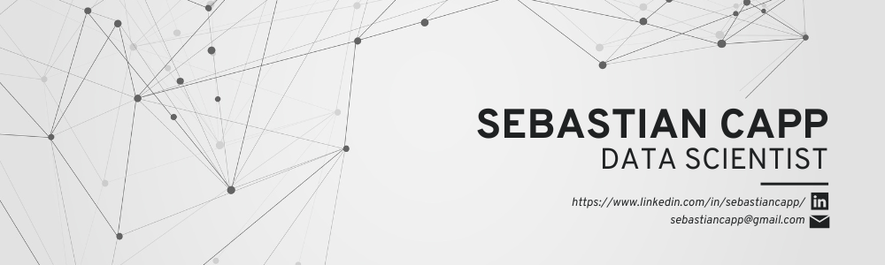

# Hi, I'm Sebastian (he/him)

My passion for data science is rooted in the belief that data, used with care, can improve the lives of people and the health of our planet. I bring a Master of Applied Data Science from the University of Michigan and seven years in higher education, most recently in health promotion and prevention, where I oversee assessment, analytics, and communications efforts.

Community lies at the core of my work. I'm drawn to data science for social good, especially in public health, social work, and environmental sustainability, where insights strengthen the programs, services, and natural systems communities depend on. I believe the intentional and ethical collaboration between data science, software development, and social work can foster a more just, equitable, and sustainable world.

## Featured work

| Project | Highlights | Stack |
| --- | --- | --- |
| [**Auto-BG: The Board Game Concept Generator**](https://github.com/sebastiancapp/Auto-BoardGame) MADS capstone | An LLM pipeline that turns BoardGameGeek tags into original board game concepts, trained on 20,769 ranked games. We tested 100 training games with BERTScore, ROUGE, and BLEURT to confirm the model writes new descriptions instead of memorizing old ones. | Python, PyTorch, Transformers, GPT-3, T5, spaCy, Streamlit |
<!--
| [**Country and Hip-Hop Song Popularity Prediction**](https://github.com/sebastiancapp/song-popularity-prediction) MADS Milestone II | I led the supervised learning, tuning Lasso, Ridge, Random Forest, and XGBoost models on 4,800+ songs. Musical features explained under 5% of popularity (R² < 0.05), and artist popularity was the strongest predictor by far. | Python, scikit-learn, XGBoost, LDA topic modeling |
| [**COVID-19 Economic Impact Analysis**](https://github.com/sebastiancapp/covid-economic-impact) MADS Milestone I | Merged Federal Reserve economic data with COVID-19 case counts and a CDC event timeline I scraped. Retail spending and personal savings spiked after each stimulus check, then returned to 2019 levels within 2 to 3 months. | Python, pandas, scikit-learn, Seaborn, BeautifulSoup |
-->
## What I work with

- **Languages:** Python (pandas, NumPy, SciPy, scikit-learn), SQL
- **Machine learning:** supervised and unsupervised learning, NLP, deep learning (PyTorch, TensorFlow)
- **Data and big data:** PostgreSQL, MySQL, SQLite, BigQuery, Spark, Hadoop
- **Visualization and BI:** Matplotlib, Seaborn, Plotly, Altair, Tableau, Power BI, Streamlit
- **Research methods:** survey and experiment design, causal inference, qualitative inquiry

## A bit more about me

- 📍 Based in Seattle, WA
- 🧱 Lifelong Lego builder
- 🎲 Always up for Catan, Coup, or any good deduction game

## Let's connect

I'm continually inspired by the people I learn from and build alongside. I'd love to connect, exchange ideas, and collaborate on work that cultivates healthier communities.

<!-- Uncomment after the portfolio launches:
**Portfolio:** [sebastiancapp.github.io](https://sebastiancapp.github.io) ·
-->
**LinkedIn:** [in/sebastiancapp](https://www.linkedin.com/in/sebastiancapp/) · **Email:** [sebastiancapp@gmail.com](mailto:sebastiancapp@gmail.com)
